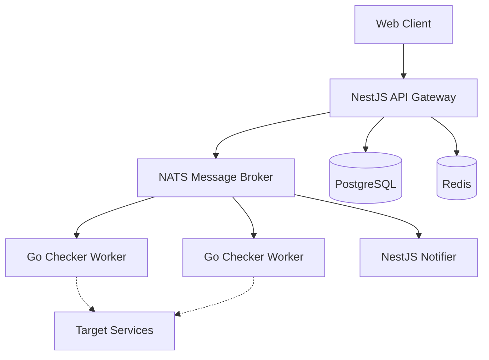

# StillAlive 🟢


> Open-source uptime monitoring platform built with microservice architecture. Monitor your websites, APIs, and services with real-time alerts and detailed analytics.

<!-- Screenshot Placeholder -->
<!--  -->

## ✨ Features
- 🔍 Multiple monitor types (HTTP, TCP, Ping, Keyword)
- ⚡ Real-time status updates
- 📊 Detailed analytics & response time charts
- 🔔 Multi-channel notifications (Email, Slack, Discord, Webhook, Telegram)
- 📄 Public status pages
- 🏗 Microservice architecture
- 🐳 Docker-ready deployment
- 📈 Prometheus + Grafana observability

## 🏛 Architecture



| Service | Tech Stack | Port |
|---------|------------|------|
| API | NestJS | 3000 |
| Web | Next.js | 3010 |
| Worker | Go | N/A |
| DB | PostgreSQL | 5432 |
| Redis | Redis | 6379 |
| NATS | NATS | 4222 |

## 🛠 Tech Stack

| Category | Technology |
|----------|------------|
| Backend | NestJS, Go |
| Frontend | Next.js 14, React 18 |
| Database | PostgreSQL 16, Prisma ORM |
| Cache | Redis 7 |
| Message Broker | NATS |
| Monitoring | Prometheus, Grafana |
| Build | Turborepo, pnpm, Docker |
| Testing | Jest, Go testing, Playwright |
| CI/CD | GitHub Actions |

## 🚀 Quick Start

### Prerequisites
- Node.js >= 20
- pnpm >= 9
- Go >= 1.22
- Docker & Docker Compose

### Installation steps:
1. Clone repo
2. Install dependencies: `pnpm install`
3. Copy `.env.example` to `.env`
4. Start infrastructure: `pnpm docker:up`
5. Run database migrations: `pnpm db:migrate`
6. Seed database: `pnpm db:seed`
7. Start all services: `pnpm dev`

## 🧪 Testing
- `pnpm test` - Run all unit tests
- `pnpm test:cov` - Run tests with coverage
- `go test ./...` - Run Go tests
- E2E tests with Playwright

## 📁 Project Structure
```
StillAlive/
├── apps/
│   ├── api/            # NestJS API Gateway
│   ├── web/            # Next.js Frontend
│   ├── checker-worker/ # Go Checking Microservice
│   └── notifier/       # Notifications Microservice
├── packages/           # Shared libraries (types, ui)
└── docker/             # Infrastructure config
```

## 🔌 API Documentation
Swagger documentation is available at `http://localhost:3000/api/docs` when the API is running.

## 📊 Monitoring
- Grafana: `http://localhost:3100`
- Prometheus: `http://localhost:9090`
- NATS Monitoring: `http://localhost:8222`

## 🤝 Contributing
Contributions, issues and feature requests are welcome!
Please follow the conventional commits specification when writing commit messages.

## 📝 License
This project is [MIT](LICENSE) licensed.
