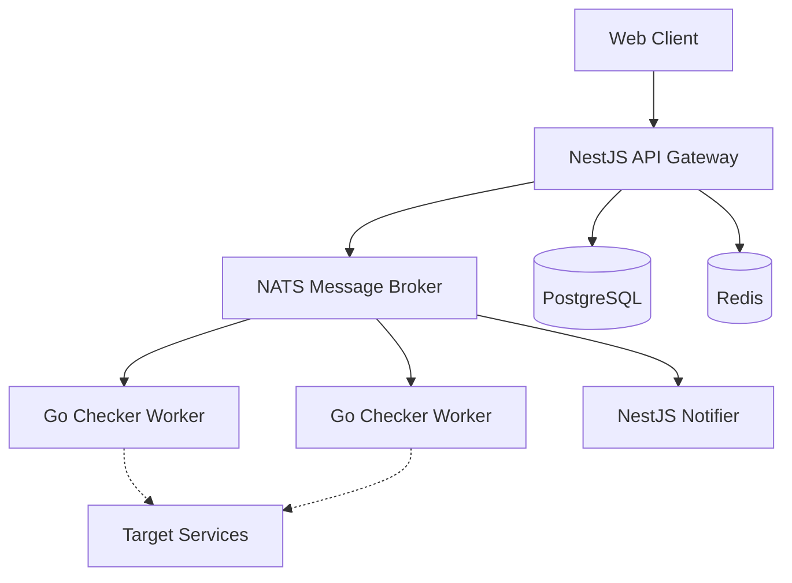

# StillAlive 🟢


> Open-source uptime monitoring platform built with microservice architecture. Monitor your websites, APIs, and services with real-time alerts and detailed analytics.

<!-- Screenshot Placeholder -->
<!--  -->

## ✨ Features
- 🔍 Multiple monitor types (HTTP, TCP, Ping, Keyword)
- ⚡ Real-time status updates
- 📊 Detailed analytics & response time charts
- 🔔 Multi-channel notifications (Email, Slack, Discord, Webhook, Telegram)
- 📄 Public status pages
- 🏗 Microservice architecture
- 🐳 Docker-ready deployment
- 📈 Prometheus + Grafana observability

## 🏛 Architecture



| Service | Tech Stack | Port |
|---------|------------|------|
| API | NestJS | 3000 |
| Web | Next.js | 3010 |
| Worker | Go | N/A |
| DB | PostgreSQL | 5432 |
| Redis | Redis | 6379 |
| NATS | NATS | 4222 |

## 🛠 Tech Stack

| Category | Technology |
|----------|------------|
| Backend | NestJS, Go |
| Frontend | Next.js 14, React 18 |
| Database | PostgreSQL 16, Prisma ORM |
| Cache | Redis 7 |
| Message Broker | NATS |
| Monitoring | Prometheus, Grafana |
| Build | Turborepo, pnpm, Docker |
| Testing | Jest, Go testing, Playwright |
| CI/CD | GitHub Actions |

## 🚀 Quick Start

### Prerequisites
- Node.js >= 20
- pnpm >= 9
- Go >= 1.22
- Docker & Docker Compose

### Installation

```bash
# 1. Clone the repository
git clone https://github.com/tixomirkin/StillAlive.git
cd StillAlive

# 2. Install dependencies
pnpm install

# 3. Configure environment
cp .env.example .env

# 4. Start infrastructure (PostgreSQL, Redis, NATS, Prometheus, Grafana)
pnpm docker:up

# 5. Run database migrations
pnpm db:migrate

# 6. Seed database with demo data
pnpm db:seed

# 7. Start all services in development mode
pnpm dev
```

### Individual Services

```bash
pnpm --filter @stillalive/api-gateway dev        # API Gateway    → :3000
pnpm --filter @stillalive/monitor-service dev     # Monitor Svc    → :3001
pnpm --filter @stillalive/analytics-service dev   # Analytics Svc  → :3002
pnpm --filter @stillalive/notification-service dev # Notification   → :3003
pnpm --filter @stillalive/web dev                 # Web Dashboard  → :3010
cd apps/checker-worker && make run                # Go Worker
```

## 🧪 Testing

```bash
pnpm test              # Run all unit tests
pnpm test:cov          # Run tests with coverage
pnpm test:e2e          # Run E2E tests

# Go worker tests
cd apps/checker-worker
make test              # Run with race detector
make test-coverage     # Generate coverage report
```

## 📁 Project Structure

```
StillAlive/
├── apps/
│   ├── api-gateway/          # NestJS — Auth, routing, rate limiting
│   ├── monitor-service/      # NestJS — CRUD monitors, scheduling
│   ├── analytics-service/    # NestJS — Uptime stats, aggregation
│   ├── notification-service/ # NestJS — Email, Slack, webhooks
│   ├── checker-worker/       # Go — HTTP/TCP/Ping checks
│   └── web/                  # Next.js — Dashboard UI
├── packages/
│   ├── shared-types/         # Shared TypeScript interfaces & DTOs
│   ├── database/             # Prisma schema & migrations
│   ├── eslint-config/        # Shared ESLint configuration
│   └── tsconfig/             # Shared TypeScript configs
├── infrastructure/
│   ├── docker-compose.yml    # Local dev orchestration
│   ├── docker/               # Multi-stage Dockerfiles
│   ├── prometheus/           # Prometheus scrape config
│   └── grafana/              # Dashboards & provisioning
└── .github/workflows/        # CI/CD pipeline
```

## 🔌 API Documentation
Swagger documentation is available at `http://localhost:3000/api/docs` when the API is running.

## 📊 Monitoring
- Grafana: `http://localhost:3100`
- Prometheus: `http://localhost:9090`
- NATS Monitoring: `http://localhost:8222`

## 🤝 Contributing
Contributions, issues and feature requests are welcome!
Please follow the conventional commits specification when writing commit messages.

## 📝 License
This project is [MIT](LICENSE) licensed.
